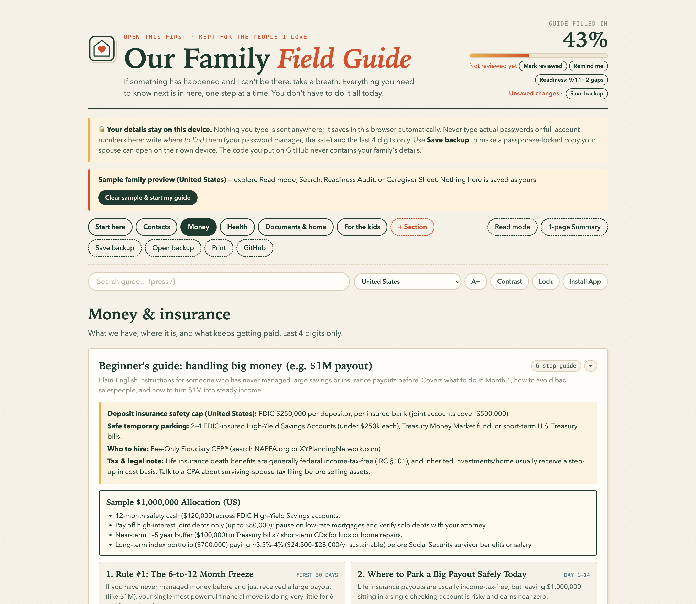

<div align="center">


# Our Family Field Guide

**A private, 100% offline emergency, medical care & digital legacy guide for the people you love.**

[](https://github.com/Dineshkumar-Ponnusamy/Family-Guide/actions/workflows/ci.yml)
[](https://github.com/Dineshkumar-Ponnusamy/Family-Guide/actions/workflows/apple.yml)
[](https://github.com/Dineshkumar-Ponnusamy/Family-Guide/actions/workflows/android.yml)
[](https://github.com/Dineshkumar-Ponnusamy/Family-Guide/actions/workflows/windows.yml)
[](https://github.com/Dineshkumar-Ponnusamy/Family-Guide/actions/workflows/linux.yml)
[](https://github.com/Dineshkumar-Ponnusamy/Family-Guide/releases/latest)
[](LICENSE)
[](SECURITY.md)

[Live Web App](https://dineshkumar-ponnusamy.github.io/Family-Guide/) · [Download Latest Release](https://github.com/Dineshkumar-Ponnusamy/Family-Guide/releases/latest) · [Security & Crypto](SECURITY.md) · [Backup Interop Spec](shared/BACKUP_FORMAT.md) · [Contributing](CONTRIBUTING.md)

</div>

---

If something happens and you can't be there—an accident, a sudden 2 AM ER visit, chronic/critical illness treatment, job loss, or passing away—your spouse or caregiver opens **one guide** and finds what to do first, who to call, where accounts, IDs, insurance, and papers live, how to handle a large payout safely, and a page written for the kids.

- **Flagship Web PWA + 5 Pure Native Developer-Preview Apps** (macOS, iOS, Android, Windows, Linux) sharing one single-source-of-truth schema and one byte-for-byte **AES-256-GCM** encrypted backup format. The **Web PWA** is the full-featured flagship experience (exporting both standalone self-contained `.html` and `.json` backups), while native apps export `.json` backups and import both `.json` and `.html` backups.
- **Zero servers · Zero accounts · Zero tracking · Zero third-party CDNs.**

---

## Screenshots

<div align="center">
  
  <br />
  <sub><em>Warm paper editorial UI, completion & readiness meter, dark Quick Glance card, and 7 Emergency Playbooks (shown with built-in Sample Family demo data).</em></sub>
</div>

<br />

<table>
  <tr>
    <td width="50%" valign="top">
      
      <p align="center"><b>Calm Read Mode &amp; 1-Page Executive Summary</b><br /><sub>Tappable contacts, accounts, policies, IDs, and active ER alerts on one printable screen.</sub></p>
    </td>
    <td width="50%" valign="top">
      
      <p align="center"><b>Beginner's Guide to Big Money &amp; Payouts</b><br /><sub>Localized 6-part survivor guide covering deposit caps, fee-only fiduciaries, and the 4-Bucket Plan.</sub></p>
    </td>
  </tr>
  <tr>
    <td width="50%" valign="top">
      
      <p align="center"><b>Chronic Illness &amp; 1-Page ER Grab Sheet</b><br /><sub>Red-flag rules, 24/7 specialist triage, ports/arm restrictions, rescue meds &amp; portal proxy.</sub></p>
    </td>
    <td width="50%" align="center" valign="top">
      
      <p align="center"><b>Mobile Calm Read Mode</b><br /><sub>Responsive phone layout alongside pure native iOS &amp; Android apps.</sub></p>
    </td>
  </tr>
</table>

---

## Download & Install (All 6 Platforms)

All native builds and offline web packages are built and published from source by GitHub Actions on every release tag (`SHA256SUMS.txt` included on every release).

| Platform | Tech Stack | Release Package | Install / Notes |
|---|---|---|---|
| **Web / PWA (Flagship)** | Vanilla HTML, CSS, JS *(zero deps)* | [Live Web App](https://dineshkumar-ponnusamy.github.io/Family-Guide/) or `Our-Family-Field-Guide-Web-Offline.zip` | Works offline from `index.html` or install via browser **Install App** / Safari **Add to Home Screen** |
| **macOS (14+)** | Pure Swift + SwiftUI + CryptoKit | `Our-Family-Field-Guide-macOS-arm64.dmg` | **Developer Preview** — Apple Silicon (`arm64`), ad-hoc signed; allow in **System Settings → Privacy & Security → Open Anyway** |
| **iOS (17+)** | Pure Swift + SwiftUI + CryptoKit | `Our-Family-Field-Guide-iOS-Xcode-Source.zip` | **Developer Preview** — Local Swift Package + Face ID `@main` entry (`native/apple/`) for Xcode |
| **Android (8.0+)** | Pure Kotlin + Jetpack Compose (M3) | `Our-Family-Field-Guide-Android.apk` *(signed)* or `Our-Family-Field-Guide-Android-PREVIEW-debug.apk` | **Zero `INTERNET` permission**; `-PREVIEW-debug.apk` is a debug-signed preview that cannot upgrade a signed release in place |
| **Windows (x64)** | Pure C# + .NET 8 + WPF | `Our-Family-Field-Guide-Windows-x64.exe` | **Developer Preview (Unsigned)** — Single-file portable `.exe` with native Windows `PrintDialog` |
| **Linux (GTK4)** | Pure Rust + `gtk4-rs` *(zero WebView)* | `Our-Family-Field-Guide-Linux-x86_64.tar.gz` | **Developer Preview (Unsigned)** — Ubuntu 24.04+ (`glibc 2.39+`, `GTK 4.12+`); extract & run `./install.sh` |

> **Latest Downloads:** [Releases Page](https://github.com/Dineshkumar-Ponnusamy/Family-Guide/releases/latest)

### Platform Feature & Signing Status Matrix

| Platform | `.html` Export | `.json` Export / Import | Photos | Print Sheets | Signing / Store Status |
|---|---|---|---|---|---|
| **Web / PWA** | Yes (Full + Caregiver/ER packet) | Export `.json` · Import `.json` & `.html` | Yes (up to 10 encrypted compressed photos) | Full HTML print sheets (Summary, ER, Caregiver, Cover, Money, Pro Finder, Full Guide, Recovery Cards) | **Flagship** — HTTPS PWA (GitHub Pages) or offline `index.html`; zero installer |
| **macOS** | No (imports `.html`) | Export `.json` · Import `.json` & `.html` | Preserved in backup state (no photo picker UI) | Share Sheet / text export (Summary & ER Grab Sheet) | **Developer Preview** — Ad-hoc signed `.dmg` (not notarized / no App Store) |
| **iOS** | No (imports `.html`) | Export `.json` · Import `.json` & `.html` | Preserved in backup state (no photo picker UI) | iOS Share Sheet (Summary & ER Grab Sheet) | **Developer Preview** — Xcode source zip (not on App Store) |
| **Android** | No (imports `.html`) | Export `.json` · Import `.json` & `.html` | Preserved in backup state (no photo picker UI) | Android Share Intent (Summary & ER Grab Sheet) | **Developer Preview** — Debug preview APK unless CI keystore secrets sign release APK (not on Play Store) |
| **Windows** | No (imports `.html`) | Export `.json` · Import `.json` & `.html` | Preserved in backup state (no photo picker UI) | Native Windows `PrintDialog` (Summary & ER Grab Sheet) | **Developer Preview** — Unsigned portable `.exe` (not Authenticode-signed) |
| **Linux** | No (imports `.html`) | Export `.json` · Import `.json` & `.html` | Preserved in backup state (no photo picker UI) | Save printable `.txt` sheets (Summary & ER Grab Sheet) | **Developer Preview** — Unsigned `.tar.gz` binary bundle (not on distro repos/Flathub) |

---

## 30-Second Privacy & Security Audit

1. **Zero network traffic & zero external dependencies:** Root Web PWA has zero CDNs/analytics; pure native apps have zero telemetry; Android declares **zero `<uses-permission>`** tags.
2. **Client-side / device-local storage only:** Web stores locally in `localStorage` (with optional AES-GCM lock, DOM/RAM wiping, and 15-min idle timeout); macOS/iOS store in Application Support (with Touch ID / Face ID + Keychain encryption + background re-lock); Android in internal `filesDir` (with `AndroidKeyStore` encryption, `FLAG_SECURE`, and `BiometricPrompt`); Windows in `%AppData%` and Linux in `$XDG_DATA_HOME/family-field-guide/` (`0600`) with persistent `state.locked.json` when locked.
3. **Byte-for-byte cross-platform AES-256-GCM backups:** Every app reads and writes the exact same `familyFieldGuide.v1` encrypted `.json` backups (`PBKDF2-HMAC-SHA256`, 250,000 iterations, 16-byte random salt, 12-byte random IV) and imports both `.json` and standalone `.html` backups. The **Web PWA** also exports standalone self-contained `.html` backups (full guide and least-privilege Caregiver/ER packets). See [shared/BACKUP_FORMAT.md](shared/BACKUP_FORMAT.md).
4. **2-of-3 Shamir Split Recovery Cards + 66-bit Diceware:** Generate **6-word passphrases from a 2,048-word Diceware list (66 bits of entropy)** using a fail-closed CSPRNG, and split your passphrase over `GF(256)` into 3 recovery cards (`FFG-1-...` · Spouse · Safe · Trusted Person) where any 2 unlock any device.
5. **Full-state readiness & privacy audits:** Automatically scans all standard and custom sections/tables to warn if a 12+ word crypto seed phrase or full national ID (SSN / Aadhaar) is accidentally entered instead of physical location + last 4 digits. See [SECURITY.md](SECURITY.md).

---

## What's Included

- **7 Actionable Emergency Playbooks + Calm Read Mode:** Hospital/incapacitation, Chronic/critical illness, Passing away, Handling big money, Money emergency, Both parents unreachable (Caregiver guide), and Work-visa/cross-border emergency—with deep-links (`↳ Money → Insurance`), Call & claim log, `A+` large text, High Contrast mode, `/` instant search, and 1-page Executive Summary.
- **Chronic & Critical Illness Care + 1-Page ER Grab Sheet:** Diagnosis/protocol, 24/7 triage line, red-flag fever rules, ports/implants & arm restrictions, rescue meds, portal proxy/HIPAA, plus 1-click **+ Section** templates.
- **Beginner's Guide to Big Money & Insurance Payouts:** 6-part plain-English survivor guide (decision freeze, deposit caps, 4-Bucket `$1M` / `₹2 Cr` / `£500k` / `€500k` allocation, fee-only fiduciaries, scam scripts, monthly routine).
- **9 Country & Cross-Border Presets:** United States, US + India (H-1B / Visa / NRI), India, Cross-Border / Work Visa (Any 2 Countries), United Kingdom, Canada, Australia, European Union, and International / Generic.
- **Crypto, Key IDs & Finding Vetted / Free Help:** Safe hardware-wallet/seed location mapping, last-4 ID mapping, and localized directories for Bar-referred lawyers, AILA/IAA/CICC/OMARA immigration counsel, fee-only fiduciaries, IRS VITA / CVITP / ATO / NALSA legal aid, EAP, and Dollar For.
- **Two-Spouse Smart Merge & Family Fire Drill:** Merge updates from two devices with conflict preview, attach up to 10 encrypted compressed reference photos, run the 10-minute annual fire drill, and export 6-month `.ics` calendar reminders.

---

## Architecture & Building From Source

All 6 platforms share one canonical schema ([schema.js](schema.js) + [regions.js](regions.js) → [shared/guide-data.json](shared/guide-data.json)) and one design token spec ([shared/design-tokens.json](shared/design-tokens.json)), continuously verified by [tests/test_design_parity.py](tests/test_design_parity.py) and [tests/web_tests.js](tests/web_tests.js).

| Path | Purpose |
|---|---|
| `index.html`, `styles.css`, `schema.js`, `regions.js`, `app.js`, `sw.js`, `manifest.json` | Zero-build, zero-dependency Web / Offline PWA |
| `shared/` | Schema exporter (`sync_schema.py`), `guide-data.json`, `design-tokens.json`, & `BACKUP_FORMAT.md` |
| `native/apple/` | Pure Swift + SwiftUI macOS & iOS package + `FamilyGuideCoreTests` & `FamilyGuideUITests` |
| `native/android/` | Pure Kotlin + Jetpack Compose + Material 3 Android app (`minSdk 26`, JUnit suite) |
| `native/windows/` | Pure C# + .NET 8 WPF app + `FamilyGuide.Core.Tests` (xUnit) |
| `native/linux/` | Pure Rust + GTK4 app & `family-guide-core` crate + Rust unit tests |
| `tests/` | `web_tests.js` & `test_design_parity.py` (hex colors, fonts, logos, icons, canonical ordering, schema sync) |
| `.github/workflows/` | Automated CI (`ci.yml`), per-platform builds, and multi-platform release workflow (`release.yml`) |

```bash
# Sync shared schema from JS source of truth & run cross-platform parity + Web tests
python3 shared/sync_schema.py
python3 tests/test_design_parity.py
node tests/web_tests.js

# Build / test native targets
swift test --package-path native/apple && swift run --package-path native/apple FamilyGuideMac
cd native/android && gradle testDebugUnitTest assembleDebug
dotnet test native/windows/FamilyGuide.Core.Tests/FamilyGuide.Core.Tests.csproj
cargo test --manifest-path native/linux/Cargo.toml -p family-guide-core
```

---

## Extending & License

- **Add custom sections in the UI:** Click **+ Section** (choose from 8 ready-made templates or build custom fields & tables).
- **Contribute a country preset or improvement:** See [CONTRIBUTING.md](CONTRIBUTING.md).
- **License:** [MIT License](LICENSE). General educational organization guidance only—not legal, tax, medical, or financial advice.
